# ED Trip Helper

One-key launch, Supercruise Assist and docking for **Elite Dangerous**.

Press **F9**, point at your target, press **F9** again, and make a cup of tea. The helper launches you, clears the station, enters supercruise, switches on Supercruise Assist, closes in after the drop, requests docking (retrying until you're in range) and hands over to your docking computer.

*Vibe coded with the legendary Claude by [Bendersordoexchao.com.au](https://bendersordoexchao.com.au).*

## How it looks

Point at your target and press F9 again...

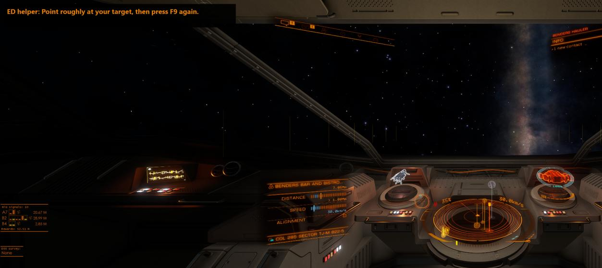

...Supercruise Assist flies you in...

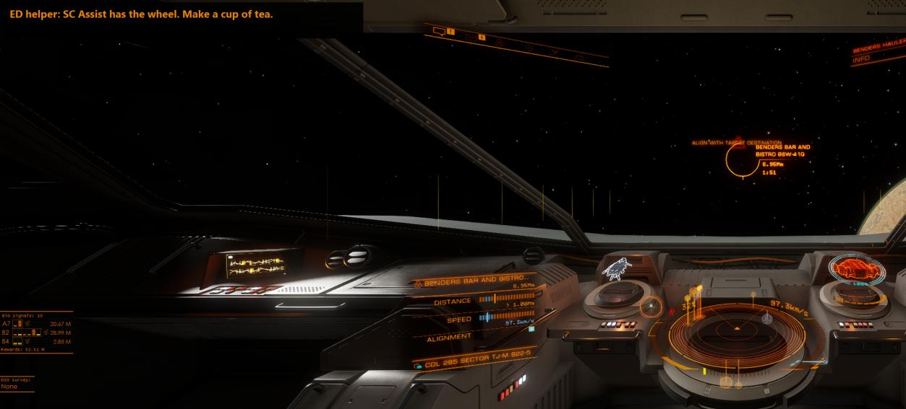

...and the docking computer takes it from there.

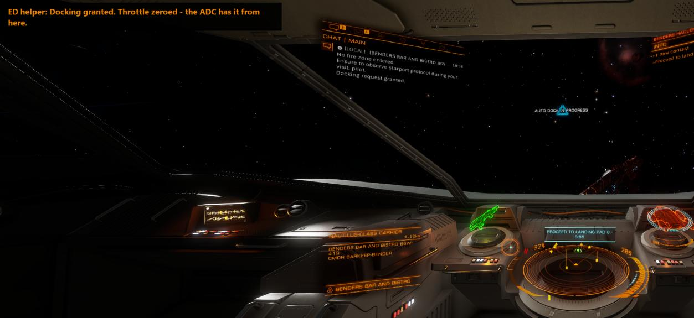

<b>Every step of a trip (click to expand)</b>

| Step | What's happening |
| --- | --- |
| 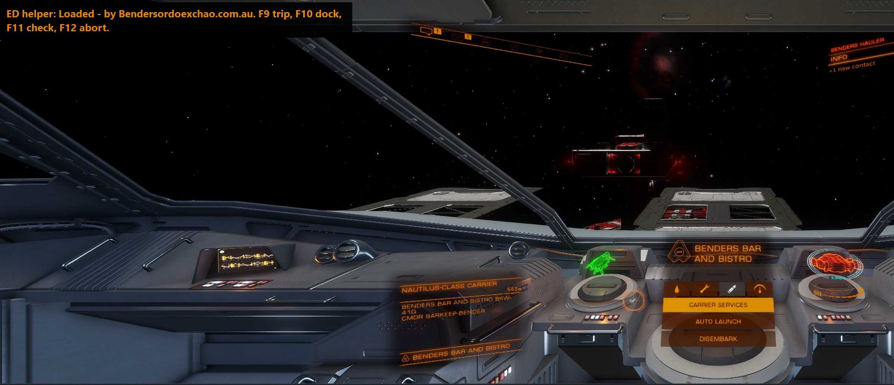 | Script loaded |
| 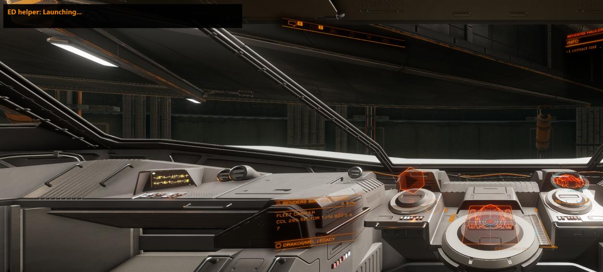 | F9 pressed: launching |
| 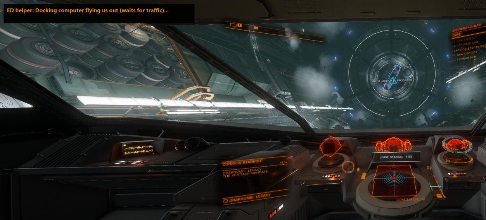 | Docking computer flies you out, waiting for traffic |
| 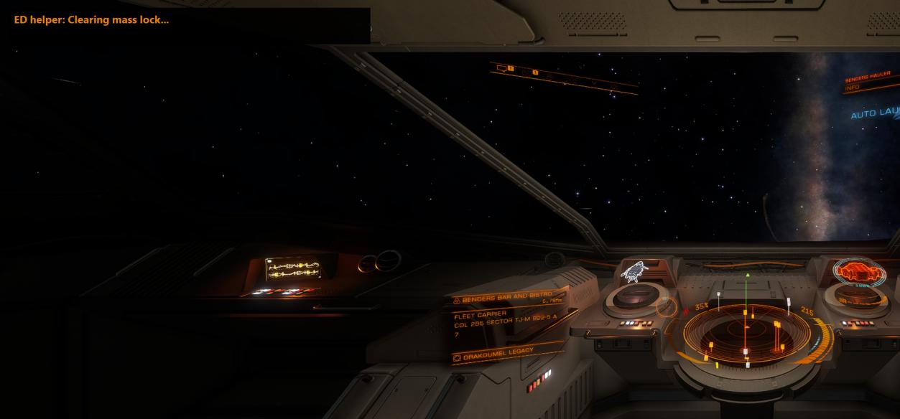 | Clearing mass lock |
| 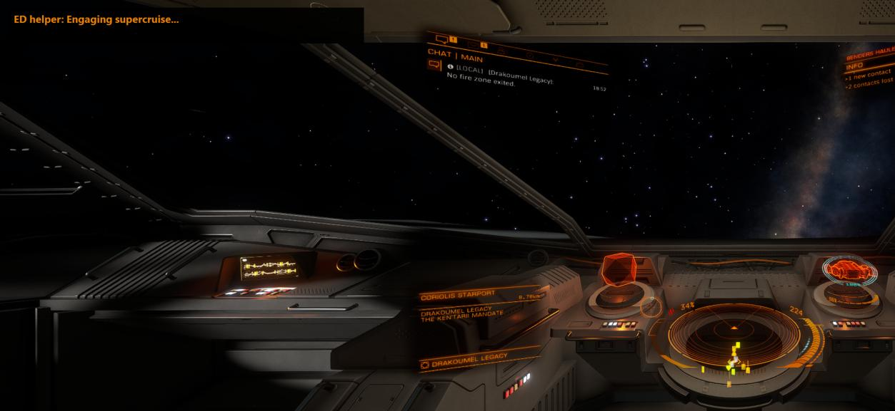 | Engaging supercruise |
|  | Point at your target, press F9 again |
|  | Supercruise Assist has the wheel |
| 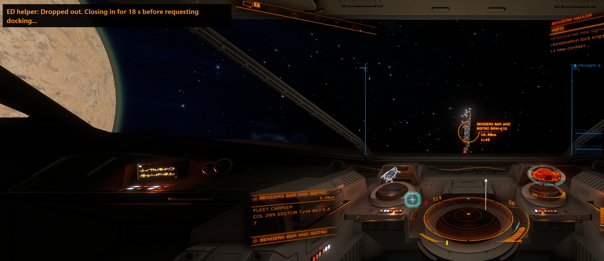 | Dropped out: closing in for 18 s |
| 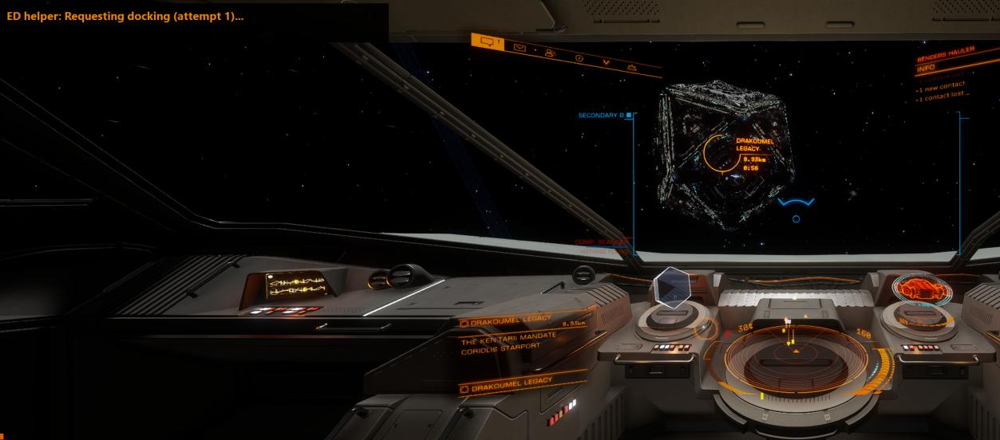 | Requesting docking |
|  | Docking granted, throttle zeroed, ADC lands you |
| 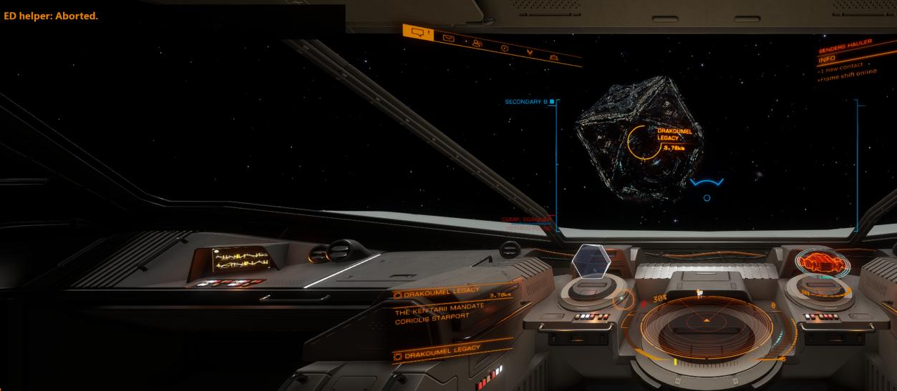 | F12 aborts at any point |

## What you need

- Windows 10 or 11
- Elite Dangerous (Steam, Epic or Frontier launcher)
- [AutoHotkey **v2**](https://www.autohotkey.com/) (free) - version 2, not 1.1
- Ship fitted with an **Advanced Docking Computer** and a **Supercruise Assist** module

## Quick start

1. Install AutoHotkey v2.
2. Download `ED_TripHelper.ahk` from this repository (click the file, then the download button).
3. Open it in Notepad and check the **YOUR KEYBINDS** block matches your Elite controls. Bind **Set Speed to 75%** and **Set Speed to 100%** in Elite (not bound by default).
4. Set Elite to **Borderless**.
5. Double-click the script and allow it to run as administrator.
6. Lock your destination on the left panel's **Navigation** tab, leave the panel on that tab, and press **F9**.

## Keys

| Key | What it does |
| --- | --- |
| F9 | Start a trip (docked or in normal space). Press again once you're pointing at the target |
| F9 in supercruise | Already in supercruise? Point at the target and press once - straight to Supercruise Assist and docking |
| F10 | Dropped out near a station yourself? Flies in at full throttle for 18 s, then requests docking (same as the end of an F9 trip) |
| F11 | Check the script can see Elite and has admin rights |
| F12 | Abort and zero the throttle |

The keys only work while Elite is the active window, so F9-F12 stay free for other programs the rest of the time.

Settings (timings, key sequences, message box style, slow mode for troubleshooting) are at the top of the script.

## Good to know

- It only presses keys you could press yourself, when you tell it to. It never flies unattended or does hyperspace jumps.
- It reads Elite's own status and journal files; it doesn't read your screen or modify the game.
- **Orbital stations and fleet carriers only.** It doesn't work with planetary ports or settlements: Supercruise Assist parks you in orbital cruise instead of dropping you near the port, so it never gets to land.
- It's a third-party tool sending keys to Elite - use at your own risk.

## Licence

Copyright 2026 Ben Rainbird ([Bendersordoexchao.com.au](https://bendersordoexchao.com.au)).

Licensed under the [PolyForm Noncommercial License 1.0.0](LICENSE.md). Free to use, share and modify for non-commercial purposes, as long as the copyright notice stays in the script. Commercial use or resale needs written permission.

Elite Dangerous is a trademark of Frontier Developments plc. This project isn't affiliated with or endorsed by Frontier.
